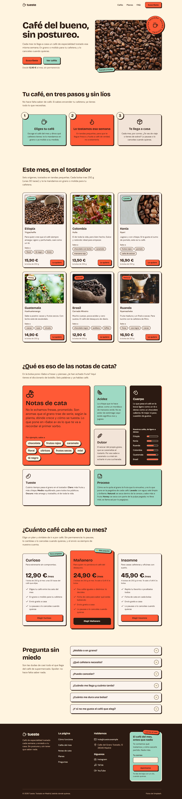

# Tueste · café de especialidad, cada mes en tu casa

Laboratorio final del módulo 1 (maquetación): landing de una sola página
hecha con HTML semántico, Tailwind CSS v4 y Vite, sin frameworks JS.

## Cómo se ha desarrollado

La web se ha hecho con **Claude Code** (el asistente de programación de
Anthropic en la terminal), pero no con un único «hazme una landing». El repo
de partida tiene una configuración propia (un *harness*) que reparte el
trabajo en fases, cada una con su herramienta, y que **obliga a demostrar con
pruebas que cada parte funciona** antes de pasar a la siguiente. 
Esa configuración vive en el repo del módulo y no se incluye aquí. En este repo 
se incluyen sus dos productos: [`brief.md`](brief.md) y
[`tareas.md`](tareas.md).

### La configuración

- **`CLAUDE.md`, las reglas del proyecto.** Claude lo lee al empezar cada
  sesión:
  - Es Tailwind v4, no v3: nada de `tailwind.config.js`; los tokens van en
    `@theme`.
  - Nada de colores «a pelo».
  - `motion-safe:` en todo lo que se mueve.
  - Las fuentes, con `@fontsource-variable`.
  - Nada está terminado sin su informe de verificación.
- **Skills**: instrucciones especializadas que Claude carga cuando la tarea
  lo pide.
  - `brief-grill`: la entrevista inicial de diseño.
  - `plan-tasks`: divide el proyecto en tareas con criterios comprobables.
  - `verify-task`: la verificación de cada tarea.
  - `tailwind-clases-limpias`: las reglas de Lemoncode para no hacer
    «churros» de clases.
  - `frontend-design`, `tailwind-design-system` y `ux-copy`: para maquetar.
  - `design-critique` y `accessibility-review`: para revisar.
- **Agentes** (subagentes con un papel y herramientas propias):
  - `tailwind-html` maqueta en HTML + Tailwind v4.
  - `design-reviewer` revisa el diseño contra el brief y no toca el código.
  - Cada verificación la hace un subagente aparte, que no ha escrito el
    código: quien lo escribe tiende a ver lo que quería hacer, no lo que hay.
- **Navegador real**: el servidor MCP de **Playwright** deja a Claude abrir
  la página, cambiar el ancho a 360/768/1440 px, recorrerla con el
  tabulador, emular «movimiento reducido» y hacer capturas. Lighthouse mide
  accesibilidad, buenas prácticas, SEO y rendimiento.
- **Hooks**: guardas automáticas que no dependen de que Claude «se acuerde».
  - Una bloquea las acciones irrecuperables (`git reset --hard`,
    `push --force`, borrar carpetas del curso o `.git`).
  - Otra, al terminar cada respuesta, compila el proyecto y pasa la
    comprobación estática si hay cambios sin commit; si algo falla, Claude
    no puede dar el trabajo por terminado.
  - Esta última se añadió a mitad del proyecto, en una revisión del
    harness. El motivo: la IA había llegado a afirmar que había hecho algo
    que no había hecho.

### El flujo

```
1 Brief ──► 2 Plan ──► 3 Construir T1 ► verificar ► ✅ ► T2 … ──► 4 Revisión ──► 5 Entrega
(brief.md)  (tareas.md)          └── ❌: arreglar y volver a verificar ──┘   de diseño     (README)
```

1. **Brief** (skill `brief-grill`). Claude me entrevistó con una pregunta
   cada vez, siempre con opciones y una recomendación: público, secciones,
   móvil, contenido, personalidad, tres direcciones visuales y movimiento.
   Yo decidía. El resultado es [`brief.md`](brief.md), la referencia de
   diseño de todo lo demás. Por eso la web es «Pegatina pop» y no la
   plantilla de café de siempre.
2. **Plan** (skill `plan-tasks`). El brief y los obligatorios del enunciado
   se convirtieron en [`tareas.md`](tareas.md): tareas pequeñas y ordenadas
   (base y tokens → cabecera → hero → cada sección → README).
   - Cada tarea tiene **criterios comprobables y cómo se mide cada uno**, por
     ejemplo: «6 `article` en `#cafes`; 1/2/3 columnas a 360/768/1440».
   - Una tabla de cobertura asegura que cada obligatorio, opcional y desafío
     tiene su tarea.
3. **Construcción, tarea a tarea.** Cada tarea se maquetaba y se
   verificaba con `verify-task` **antes de empezar la siguiente**. Las
   comprobaciones de esa verificación:
   - el build;
   - la comprobación estática (Tailwind v4, tokens, `motion-safe:`, foco…);
   - el navegador real a 3 anchos (scroll horizontal, contraste medido de
     cada texto, foco visible con el tabulador, movimiento reducido);
   - Lighthouse;
   - los criterios de la tarea, uno a uno;
   - que no se hubiera roto ninguna tarea anterior.

   El veredicto (PASA / FALLA, con evidencias) queda apuntado en
   `tareas.md`. Cada tarea que pasaba era un commit.
4. **Revisión de diseño** (agente `design-reviewer`). Con todo construido,
   revisó la web contra el brief con una pregunta clave: ¿podría ser la web
   de cualquier otro sitio? Sacó 10 puntos y elegí arreglarlos todos. Entraron
   en el plan como tareas nuevas (**R1–R6**), con sus criterios y su
   verificación, igual que las demás.
5. **Entrega** (T10). Este README, las capturas y una verificación final de
   la página entera contra los obligatorios del enunciado.

En total, 17 tareas (T1–T10, T2b y R1–R6), todas verificadas. Hasta R1 las
maquetó el agente `tailwind-html`. Las últimas (R2–R6 y T10), más pequeñas,
las hizo directamente Claude, y pasaron por la misma verificación. Mientras
tanto, la **bitácora de IA** se iba escribiendo tarea a tarea; al final de
este README quedan cinco ejemplos.

## Tema

**Tueste** es un tostadero ficticio que vende café de especialidad por
suscripción. La web habla a quien bebe café de supermercado y quiere probar
algo mejor, pero se asusta con los tecnicismos. Por eso el orden es
**primero explicar, luego vender**: hero → cómo funciona → cafés del mes →
glosario de cata en bento → planes → preguntas frecuentes → pie con
newsletter.

Dirección visual **«Pegatina pop»**: el paquete de café como objeto gráfico.

- Fondo crema, marca *espresso* (escala 50–950), acento tomate y un toque de
  menta, todo como tokens en `@theme`.
- Bricolage Grotesque para títulos y DM Sans para texto, instaladas con
  `@fontsource-variable`.
- Bordes gruesos, sombras duras sin difuminar y etiquetas giradas como
  pegatinas.
- Detalle memorable: todo lo clicable «se aplasta» al pulsarlo, y un sello
  «Recién tostado» gira en la esquina de la foto del hero.

El brief completo está en [`brief.md`](brief.md) y el plan de tareas, con
la verificación de cada una, en [`tareas.md`](tareas.md).

## Cómo arrancarlo

```bash
npm install
npm run dev       # servidor con recarga en http://localhost:5173
npm run build     # versión final en dist/
npm run preview   # sirve dist/ en http://localhost:4173
```

## Tailwind: opción 1, plugin de Vite

Uso `@tailwindcss/vite` (la opción 1 del enunciado). Motivos:

- **Es lo más sencillo:** una línea en `vite.config.js` y
  `@import "tailwindcss";` en `src/style.css`. No hace falta
  `postcss.config.js` ni configurar nada más.
- **No necesitaba PostCSS:** la opción 2 tiene sentido si ya hay una cadena
  de PostCSS con otros plugins. Aquí no la había.
- **Es más rápido:** el plugin está integrado en Vite y la recarga en
  desarrollo es casi instantánea.

Toda la configuración va en el CSS, como pide la v4. Los tokens están en
`@theme`, las utilidades propias en `@utility`, y no hay `tailwind.config.js`.

## Capturas

| Móvil (360 px) | Escritorio (1440 px) |
|---|---|
|  |  |

## Lighthouse

Las notas son de Lighthouse en móvil, sobre `npm run build` servido en
local.

| Accesibilidad | Buenas prácticas | SEO | Rendimiento |
|---|---|---|---|
| **100** | **100** | **100** | 92 |

En rendimiento, el LCP (la foto del hero) ronda los 3,2–3,3 s en la
simulación de móvil lento. Las fotos van en WebP con `width`/`height`,
`loading="lazy"` (salvo la del hero, que lleva `fetchpriority="high"`) y
`srcset` + `sizes` con versiones de 400 px.

## Checklist

### Obligatorios

- [x] **O1 · Estructura semántica.** Hay `header`, `nav`, `main`, una
  `section` con su título por bloque, y `footer`. Un solo `h1` y ningún
  salto de nivel. Las tarjetas son `article`, las listas de enlaces `ul` y
  todas las imágenes llevan `alt`.
- [x] **O2 · Tema con `@theme`.** Escala *espresso* 50–950, tomate, menta y
  crema; fuentes propias; tokens de sombra y animaciones. Ningún color «a
  pelo» en el HTML.
- [x] **O3 · Cabecera con flexbox.** Logo a la izquierda y menú a la
  derecha. Los enlaces tienen `hover` y `focus-visible`.
- [x] **O4 · Hero.** Titular, texto con `max-w-xl`, dos botones y foto. En
  una columna en móvil y en dos desde `md` con grid (dos columnas iguales,
  sin tener que repartir anchos a mano).
- [x] **O5 · Rejilla de tarjetas.** 6 cafés en 1 / 2 / 3 columnas, cada uno
  con foto 4:3 y `object-cover`, título, texto, precio y botón. Al pasar el
  ratón, la tarjeta sube y su sombra crece.
- [x] **O6 · Pasos con flexbox.** «Tu café, en tres pasos»: en columna en
  móvil y en fila desde `md`, con el contenido centrado.
- [x] **O7 · Pie.** 4 columnas en escritorio, 2 en tablet y 1 en móvil, con
  el copyright separado por un borde.
- [x] **O8 · Accesibilidad mínima.** Todo se puede usar con teclado y el
  foco se ve siempre. El contraste está medido (nunca texto blanco sobre
  tomate) y no hay texto dentro de imágenes. Lighthouse de accesibilidad:
  100.
- [x] **O9 · README + bitácora de IA.** Este fichero.

### Opcionales

- [ ] P1 · Modo oscuro
- [ ] P2 · Cabecera fija con efecto cristal
- [x] **P3 · Plan destacado.** Mañanero va en el centro, en tomate, con
  sombra más larga, un poco más alto que los otros y con la etiqueta «⭐ Más
  popular» en `absolute`. Curioso lleva «Para empezar».
- [x] **P4 · FAQ sin JavaScript.** Seis `details`/`summary`. La flecha gira
  con `group-open:rotate-180` y su transición se quita con
  `motion-reduce:`.
- [ ] P5 · Formulario con estados. La newsletter tiene `label` y foco, pero
  no mensajes de error con `peer-invalid:`.
- [x] **P6 · Bento grid.** El glosario de cata: un mosaico de 4 × 3 desde
  `xl`, con cajas `col-span-2` y `row-span-2`. En `sm` pasa a 2 columnas con
  `grid-flow-dense` y en móvil a 1.
- [x] **P7 · Animaciones con cabeza.** El hero entra en cascada con una
  animación propia (`animate-aparecer` en `@theme`), el sello gira y los
  botones y tarjetas se aplastan. Todo con `motion-safe:` o dentro de
  `@media (prefers-reduced-motion: no-preference)`, salvo la flecha de la
  FAQ: su giro marca si la pregunta está abierta, así que se mantiene y con
  `motion-reduce:transition-none` solo se quita la transición.

### Desafíos

- [x] **D1 · Menú hamburguesa sin JavaScript**, con `details` (ver
  [más abajo](#d1--el-menú-hamburguesa-sin-js-y-sus-pegas)).
- [ ] D2 · Container queries
- [ ] D3 · Multitema
- [x] **D4 · Utilidades propias con `@utility`** (ver
  [más abajo](#d4--cuándo-crear-una-utilidad-y-por-qué-no-abusar-de-apply)).
- [ ] D5 · Layout de aplicación
- [ ] D6 · De captura a código
- [x] **D7 · Lighthouse al 100.** Accesibilidad, buenas prácticas y SEO a
  100, y rendimiento 92.

## D1 · El menú hamburguesa sin JS y sus pegas

El menú usa `<details class="peer">` con solo un `<summary>` (☰/✕) dentro,
que hace de interruptor. La lista de enlaces va justo después, como hermana,
y se enseña con `peer-open:flex`. Desde `md` el `details` se esconde y la
misma lista se pone en fila, así que solo hay una lista de enlaces y el
lector de pantalla no los oye repetidos.

**Las dos técnicas sin JS tienen pegas de accesibilidad:**

**`<input type="checkbox">` + `peer-checked:`**
- El lector de pantalla anuncia una **casilla de verificación** («casilla,
  no marcada»), no un botón que abre un menú.
- Para que no se vea la casilla hay que esconderla. Si se esconde con
  `hidden` o `display: none`, **ya no se puede enfocar con el teclado**, y el
  `<label>` (que es lo que se ve como ☰) no recibe el foco. Hay que usar
  `sr-only` y pintar el foco en el label con `peer-focus-visible:`.
- Una casilla se activa con Espacio, **no con Enter**, que es lo que espera
  quien cree que está ante un botón.
- No hay `aria-expanded`: sin JS nadie avisa de si el menú está abierto.

**`<details>` / `<summary>` (la que usé)**
- Es mejor punto de partida. El `summary` es un control nativo que se
  enfoca, se abre con Enter y con Espacio, y anuncia si está **expandido o
  contraído**.
- **La pega de mi versión:** la lista va **fuera** del `details` (para poder
  ponerla en fila en escritorio). El lector anuncia «Menú, expandido», pero
  dentro del `details` no hay nada: la relación entre el botón y los enlaces
  se pierde. Funciona porque la lista va justo después en el orden del
  documento: tras abrir, el siguiente Tab lleva a «Cafés».
- **No se cierra solo:** ni con Escape, ni al pulsar fuera, ni al elegir un
  enlace. Si pulsas «Cafés», la página baja a la sección pero el menú queda
  abierto en la cabecera. Cerrarlo así necesitaría una línea de JS.
- El triángulo nativo hay que quitarlo a mano (`list-style-type: none` y
  `::-webkit-details-marker`, en la utilidad `menu-boton`), y algunos
  lectores antiguos anuncian el `summary` de forma irregular.

## D4 · Cuándo crear una utilidad y por qué no abusar de `@apply`

La página tiene 17 utilidades propias en `src/style.css`: `btn-pegatina`,
`pegatina`, `tarjeta-pegatina`, `cafe-tarjeta`, `faq-item`, `menu-boton`,
`cuerpo-barra`… Todas están escritas en **CSS normal con tokens**
(`var(--color-espresso-900)`, `var(--shadow-pegatina)`), **sin `@apply`**.

**Cuándo merece la pena una utilidad en CSS:**
- **El mismo conjunto de clases se repite con el mismo significado en
  muchos sitios.** El botón «se aplasta» tenía 19–23 clases y está en la
  cabecera, el hero, las 6 tarjetas, los planes y el pie. Con
  `btn-pegatina` cada botón se queda en 5–7 clases y, si cambia el
  efecto, se cambia en un solo sitio.
- **Hay estados difíciles de leer como clases:** el `:hover` dentro de
  `@media (hover: hover)` (para que en móvil no se quede pegado), el
  `translate` solo sin reduced motion, o el foco de la FAQ con
  `:has(> summary:focus-visible)`. En CSS se leen mejor que en una ristra
  de variantes.

**Dentro va la forma y el efecto; fuera, en el HTML, lo que cambia en cada
sitio:** color, padding, posición y giro. Por ejemplo, `btn-pegatina px-6
py-3 bg-tomate-500 text-espresso-900` o `pegatina absolute top-3 left-3
-rotate-3 bg-menta`. Como `@utility` vive en la capa de utilidades, un
`bg-*` o un `px-*` del HTML la puede cambiar sin pelear por especificidad.

**Cuándo es mejor repetir clases:** si algo sale una o dos veces con pocas
clases, o si cada copia es distinta. Pero que un elemento sea único no
justifica un «churro»: si pasa de ~12 clases porque lo engordan los estados
(`hover:`, `active:`, `focus-visible:`), va a una `@utility` aunque se use
una sola vez. Es lo que pasó con el botón ☰ (`menu-boton`) y con el campo de
correo (`pie-campo`). **Cuándo es mejor un componente de HTML/JS:** si lo que se
repite es la **estructura** (el marcado y el contenido de una tarjeta de
café, por ejemplo). Eso lo resuelve una plantilla o un componente (Astro,
React…), no el CSS. Aquí, sin frameworks, las 6 tarjetas se repiten en el
HTML.

**Por qué abusar de `@apply` es mala práctica:**
- **Vuelve a las clases semánticas de siempre** (`.card`, `.btn`) y pierde
  lo bueno de Tailwind: ver en el HTML cómo es cada elemento sin saltar al
  CSS.
- **El CSS vuelve a crecer:** cada `@apply` copia las declaraciones, en vez
  de reutilizar las utilidades que ya existen.
- **Trae problemas de orden y especificidad**, y las variantes dentro de
  `@apply` (`hover:`, `md:`) se leen y se depuran mal.
- **Es una abstracción prematura:** se le pone nombre a algo antes de saber
  si de verdad se repite.

Mi regla: primero repetir clases en el HTML. Paso a `@utility` en CSS
normal cuando lo mismo sale varias veces y es una «pieza» con nombre propio,
o cuando un elemento pasa de ~12 clases por sus estados. La única lista
larga que queda es la del menú (`<ul>`, 20 clases), y es a propósito: lo que
la alarga no son estados, sino el cambio de panel en móvil a fila en
escritorio (`md:`). Meterlo en una utilidad escondería justo eso.

## Créditos

Fotos de [Unsplash](https://unsplash.com), con la
[Licencia de Unsplash](https://unsplash.com/license). Cada enlace se ha
comprobado abriendo la página de la foto:

| Dónde | Autor | Foto |
|---|---|---|
| Hero | Łukasz Rawa | [Granos de café sobre fondo negro](https://unsplash.com/photos/brown-coffee-beans-on-black-surface-fmc-tFMMiBs) |
| Etiopía | pariwat pannium | [Granos de café con taza blanca](https://unsplash.com/photos/coffee-beans-with-white-cup-S8daAB_nJSg) |
| Colombia | Carlos Felipe Ramírez Mesa | [Mano con cerezas de café](https://unsplash.com/photos/a-person-holding-a-bunch-of-berries-Ni7Cfu8AIMI) |
| Kenia | Alin Luna | [Granos en cuenco blanco](https://unsplash.com/photos/brown-coffee-beans-on-white-ceramic-bowl-lGl3spVIU0g) |
| Guatemala | Gerson Cifuentes | [Cerezas de café en la rama](https://unsplash.com/photos/shallow-focus-photography-of-coffee-bean-W1VqcpcnSHk) (recortada: la mitad izquierda, sin el desenfoque claro del primer plano) |
| Brasil | Tina Guina | [Saco de granos de café](https://unsplash.com/photos/shallow-focus-photography-of-coffee-beans-in-sack-obV_LM0KjxY) |
| Ruanda | Eiliv Aceron | [Café de filtro](https://unsplash.com/photos/person-pouring-water-in-clear-glass-jar-XP5zW2ngk9w) |

Iconos de [Lucide](https://lucide.dev) (licencia ISC), copiados como SVG en
línea.

# 🤖 Bitácora de IA

Cinco ejemplos elegidos entre las entradas que se fueron escribiendo tarea a
tarea. 
Lo interesante no es lo que la IA hizo bien, sino **lo que hubo que corregir**.

**Herramienta:** Claude Code (Claude Opus) con las skills y agentes del repo:

- `brief-grill`: entrevista para el brief.
- `plan-tasks`: el plan de tareas con criterios comprobables.
- Agente `tailwind-html`: la maquetación.
- `verify-task`: la verificación de cada tarea, hecha por un subagente que no
  escribió el código. Incluye build, comprobación estática, navegador real a
  360/768/1440 y Lighthouse.
- Agente `design-reviewer`: la revisión de diseño contra el brief.

---

## 1 · T2 · Cabecera con menú hamburguesa sin JS (2026-10-11)

### Prompt

"Construye T2: logo, menú Cafés / Planes / FAQ y botón «Suscríbete» que se
aplasta (texto espresso sobre tomate, sombra dura, `motion-safe:` en los
`translate`). En móvil, hamburguesa sin JS con `<details>`/`<summary>`."

### Qué me dio

Una cabecera flex con un truco limpio: el `<details class="peer">` solo
lleva el `<summary>` (☰/✕) y hace de interruptor; la lista `<ul>` va al lado,
como hermana, y se enseña con `peer-open:flex`. Desde `md` el details
desaparece y la misma lista se pone en fila: una sola lista, sin enlaces
duplicados para el lector de pantalla. Añadió el token
`--shadow-pegatina-lg` en vez de una sombra arbitraria.

### Qué corregí y por qué

- La primera versión no cabía a 360 px: con la palabra «Menú» visible en el
  botón, el logo se partía en dos líneas. Se cambió a un botón ☰ de 44×44 px
  con «Menú» en `sr-only` (lo sigue leyendo el lector de pantalla) y
  `whitespace-nowrap` en el logo.
- La verificación avisó de un coste de accesibilidad de la técnica: como la
  lista está fuera del `<details>`, el lector de pantalla anuncia el botón
  como «expandido» aunque dentro no hay nada. Se usa bien con teclado (abrir y
  Tab lleva a «Cafés») y Lighthouse da 100, pero es la pega que hay que contar
  en el README para el D1.
- El botón quedó con 23 clases, y se va a repetir en hero, tarjetas y planes:
  candidato a `@utility` (D4) antes de copiarlo.
- La IA añadió `ontouchstart=""` en el `<body>` (truco para que iOS Safari
  active `:active` al tocar). Lo quité: no lo sabría explicar en la revisión,
  y solo se pierde el «aplastado» al tocar en iPhone.

## 2 · T3 · Hero con sello giratorio (2026-10-11)

### Prompt

"Construye el hero: `h1`, subtítulo con `max-w-xl`, «Suscríbete» y «Ver
cafés» con `btn-pegatina`, una foto de Unsplash y un sello SVG «Recién
tostado ·» que gire despacio en la esquina de la foto, con `motion-safe:`.
Entrada en cascada con `animate-aparecer`."

### Qué me dio

Hero en **grid** (`md:grid-cols-2`): en móvil una columna sin clases extra,
y desde `md` dos columnas iguales; con flex habría que cambiar la dirección y
dar `basis-1/2` a cada hijo. Animaciones propias en `@theme`
(`--animate-girar` 16 s, `--animate-aparecer` 0,6 s) con sus `@keyframes`.
Titular «Café del bueno, sin postureo.»

### Qué corregí y por qué

- La primera versión del sello creaba **12 px de scroll horizontal a 360 px**:
  al girar, las esquinas del cuadrado del SVG se salían del círculo. Se
  arregló con `overflow-hidden` en el círculo (recorte local; la verificación
  comprobó que sin él el scroll vuelve y que no esconde texto).
- Si giraba el sello entero, la sombra dura daba vueltas con él. Ahora el
  círculo y su sombra se quedan quietos y solo gira el SVG del texto.
- El titular de ejemplo («Café recién tostado…») repetía las palabras del
  sello que tiene al lado; se cambió.
- La IA descartó una foto de un paquete porque se veía una marca real.
- **La IA dio un enlace erróneo al autor de la foto**: usó el ID del fichero
  de `images.unsplash.com` como si fuera el de la página
  (`unsplash.com/photos/photo-…` → «Page not found»). El autor queda
  pendiente de identificar. Ni buscando se encontró la página original, así
  que **cambié la foto** por una parecida elegida por mí, con autor y licencia
  a la vista: Łukasz Rawa, Unsplash License.
- Lighthouse avisa de Rendimiento 95: la foto es un JPG de 232 KB para un
  hueco de 520 px y le falta `fetchpriority="high"` (es la imagen más grande
  de la primera pantalla, la que marca el LCP). Con la foto nueva en **WebP
  de 800×600 y 155 KB** (comparé 4 combinaciones de tamaño y calidad) y
  `fetchpriority="high"`: Rendimiento 95 → 97 y LCP 2,9 s → 2,6 s. También
  cambié el `alt`: el anterior decía «brillantes» y estos granos no lo son.

## 3 · T8 · Preguntas frecuentes (2026-10-11)

### Prompt

"Construye la FAQ después de los planes: 6 preguntas de principiante en
`<details class="group">` sin JavaScript, con una flecha que gire al abrir
(`group-open:rotate-180`), y la transición con `motion-safe:`. Respuestas que
no contradigan lo que ya dice la página."

### Qué me dio

«Pregunta sin miedo»: a 1440, título en la columna izquierda (1/3) y las
6 preguntas en los 2/3 de la derecha (`lg:grid-cols-3` + `lg:col-span-2`);
apilado por debajo de `lg`. Cada pregunta es una pegatina que pasa a menta al
abrirse (`open:bg-menta`), con la flecha `chevron-down` de Lucide. Tres
utilidades nuevas: `faq-item`, `faq-pregunta` y `faq-flecha`. No metió `h3`
dentro del `summary`, porque el `summary` funciona como un botón y algunos
lectores pierden el encabezado o el botón.

### Qué corregí y por qué

- **La IA no hizo lo que le pedí, y tenía razón.** Le pedí la transición
  con `motion-safe:`, pero `check-estatico` marca FALLA el
  `group-open:rotate-180` si no lleva `motion-safe:` o `motion-reduce:`, y si
  ponía `motion-safe:` en el giro, con movimiento reducido la flecha no
  giraría y se perdería la señal de abierto/cerrado. Dejó
  `transition-transform group-open:rotate-180 motion-reduce:transition-none`:
  con reduce la flecha queda girada al instante, sin animación. La
  verificación lo dio por bueno: lo que se mueve es la transición, y con
  reduce desaparece.
- La flecha la copió de memoria; la verificación la comparó con el fichero
  original de Lucide y coincide.
- El comentario del CSS decía que el foco iba «4 px hacia dentro» y el
  código ponía `-6px`; corregí el comentario.
- Las respuestas no contradicen la página (sin permanencia, envío de nuestra
  cuenta, 250 g ≈ 30 tazas…). Añaden dos datos nuevos compatibles: «2 o 3
  días laborables» y que las cafeteras de cápsulas no sirven.
- Pendiente para diseño: el foco de las preguntas es fino y del mismo color
  que el borde (parece un doble borde), y «eliges otro de los seis» puede
  hacer pensar que los orígenes no cambian cada mes.

## 4 · R4 · Planes: elegir plan y empujar el de entrada (2026-10-12)

### Prompt

"Al pulsar un plan, que en la newsletter salga un aviso tipo «¡Buena
elección!» sin JS (`group-target:`). Pegatina «Para empezar» en Curioso.
«Más popular» después del `h3`. A 768 las tarjetas alineadas con el título y
a 1440 los precios a la misma altura. Cambia «Sea el café que sea»."

### Qué me dio

El aviso con `hidden … group-target:block` y `group` en `#newsletter`; las
dos pegatinas después de su `h3` (son `absolute`, se ven igual); quitar el
`mx-auto` de la lista para alinearla con el `h2`; `lg:pt-14` en el destacado
para compensar los 24px que sobresale. También lo hizo el agente principal.

### Qué corregí y por qué

- **Un fallo que el criterio no veía**: el formulario tenía
  `action="#newsletter"`, así que al enviar el correo `#newsletter` volvía a
  ser `:target` y salía «¡Buena elección!» sin haber elegido nada. El form
  pasa a apuntar a su propio id (`#newsletter-form`).
- **Medir, no suponer**: con `lg:pt-14` creía que los precios ya cuadraban,
  pero al medir Curioso quedaba 24px más arriba: su frase cabía en una línea
  y las otras en dos. `lg:min-h-12` en las tres frases (dos líneas siempre)
  y 0px de diferencia a 1024, 1280 y 1440.
- Cambié dos veces el texto de Curioso: «La bolsa, a 12,90 €» repetía el
  precio de justo encima. Quedó «unas 30 tazas del café que elijas».
- Aviso de la verificación, sin arreglar: al llegar a `#newsletter` el foco
  no se mueve, así que con lector de pantalla el aviso solo se oye si se lee
  el bloque. Sin JS no hay forma limpia de anunciarlo.

## 5 · El botón ☰ y el límite de clases (2026-10-12)

### Prompt

"Explícame cuáles son los 2 avisos de siempre" (los de la comprobación
estática) y después: "¿Estos avisos de exceso de clases están documentados
como limitante en el enunciado del lab?"

### Qué me dio

Explicó los dos avisos de «más de 12 clases»: el `<summary>` del botón ☰
(15) y el `<ul>` del menú (20). Del primero dijo que estaba bien así:
«solo hay un botón así, y extraerlo a una utilidad solo movería las clases a
otro fichero». Al preguntarle si el enunciado ponía ese límite, lo buscó: no
lo pone. Viene de la guía de Lemoncode del repo (`tailwind-clases-limpias`).

### Qué corregí y por qué

- **Su propia justificación iba contra la guía**, que dice: «Ser un elemento
  único no es excusa para pasar del límite. Si lo que engorda son variantes
  de estado (`focus:`, `hover:`…), se extraen a un `@utility` con
  nombre». Y 5 de las 15 clases eran estados (`hover:`, `active:` y tres
  de `focus-visible:`). Además, el aviso se arrastraba desde T2 sin que
  nadie lo hubiera decidido.
- Se extrajo `@utility menu-boton`: forma, triángulo nativo fuera, y hover,
  active y foco como en `menu-enlace`. El `<summary>` pasa de 15 clases a
  1.
- El README (D4) decía lo mismo que la IA («una utilidad para un solo sitio
  solo esconde las clases en otro fichero»). Lo corregí para que diga lo que
  dice la guía.
- El aviso del `<ul>` se queda: lo alargan los breakpoints (`md:`), no
  los estados, y ya se había aceptado en R1.
